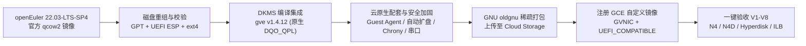

# openEuler on Google Cloud (Compute Engine 自定义镜像构建与验证套件)

本仓库提供一套经过端到端验证的工具链与详细操作文档，帮助用户在自己的 Google Cloud 环境内**独立构建、导入并验证适配第三代/第四代 Compute Engine 实例（如 `N4`、`N4D`、`C3`）及通用实例（如 `N2`）的 `openEuler 22.03-LTS-SP4` 自定义系统镜像**。

---

## 一、背景与解决的问题

在将 `openEuler 22.03-LTS-SP4`（Linux 5.10 内核）作为自定义镜像导入 Google Cloud Compute Engine 并创建新一代机型（例如 `N4` / `N4D`）时，通常会遇到以下三类问题：

1. **默认缺少 gVNIC 网卡驱动与镜像特性标签**：
   * `N4`、`N4D`、`C3` 等新一代实例仅支持 **Google Virtual NIC (`gVNIC`)** 与 **NVMe (Hyperdisk)**，不再提供传统的 `VirtIO-Net` / `VirtIO-SCSI`。
   * `openEuler 22.03` 默认内核未开启 `CONFIG_GVE`；同时若导入镜像时未声明 `GVNIC` 与 `UEFI_COMPATIBLE` 特性，创建实例会直接报错：
     `NetworkInterfaceNicType can only be set to GVNIC on instances with GVNIC GuestOsFeature`。
2. **Linux 5.10 内置旧版驱动无法释放第四代实例性能**：
   * 即使单独编译 Linux 5.10 内核源码自带的早期 `gve` 模块，它也仅支持早期的 `GQI` 队列模式，在 `N4` / `N4D` 上只能走兼容转译层，且不支持大帧（Jumbo Frames MTU 8896）、在线队列扩容与新版电源管理回调。
   * 而直接拉取 Google 官方最新版开源驱动仓库 [compute-virtual-ethernet-linux](https://github.com/GoogleCloudPlatform/compute-virtual-ethernet-linux)（如 `v1.4.12`）在 `openEuler 22.03` 上编译时，由于 `openEuler` 在 5.10 内核中回合了高版本内核的网卡参数接口但版本号仍为 `5.10.0`，会触发条件编译宏不匹配错误。
3. **云端首次启动与运维配套差异**：
   * 官方 `openEuler` 云镜像默认面向 OpenStack 环境预置了 `cloud-init`，并将 `/boot` 独立存放在 `vfat` 分区；直接转换导入容易出现 UEFI 首启找不到引导项、盘符漂移、根分区无法随 Hyperdisk 自动扩容、内部负载均衡健康检查不通等问题。

### 本方案的核心能力



* **满血硬件卸载（原生 `DQO_QPL`）**：通过精准适配补丁编译集成 `compute-virtual-ethernet-linux v1.4.12`，在 `N4`（Intel Emerald Rapids）与 `N4D`（AMD EPYC Turin）上原生启用 **Queue Format 4 (`DQO_QPL`)** 与硬件流表卸载（Flow Steering）。
* **跨代际一镜通用**：通用 `initramfs` 同时内置 `gve`、`nvme` 与 `virtio` 驱动，一套镜像可同时启动第四代 `N4`/`N4D`、第三代 `C3` 及第二代 `N2` 实例。
* **完整 Google Cloud 平台集成**：预装 `google-guest-agent`，原生支持项目/实例元数据 SSH 密钥免密登录、启动/关机脚本、Hyperdisk 首启根分区在线自动扩容、Google 内部 NTP 闰秒平滑同步以及区域内部直通式负载均衡（ILB `proto 66` 路由）。
* **全参数化与零环境耦合**：所有项目 ID、存储桶、可用区、VPC 网络、内核版本均通过 `.env` 或命令行参数传入，脚本对未替换占位符会自动提示用户输入。
* **符合 Google Cloud 官方制镜与导入规范**：全面对齐官方 [构建自定义镜像要求 (`building-custom-os`)](https://docs.cloud.google.com/compute/docs/images/building-custom-os)、[手动导入现有镜像 (`import-existing-image`)](https://docs.cloud.google.com/compute/docs/import/import-existing-image) 与 [配置导入镜像 (`configuring-imported-images`)](https://docs.cloud.google.com/compute/docs/import/configuring-imported-images) 的虚拟硬件驱动、必需内核选项、内核安全基线及稀疏归档要求（详见 [官方规范逐项对照表](docs/gcp-compliance-and-faq.md)）。

---

## 二、仓库目录结构

```text
.
├── README.md                              # 项目说明与快速上手指南
├── env.example                            # 参数配置模板（复制为 .env 后填入实际环境参数）
├── patches/
│   └── gve-1.4.12-openeuler-2203.patch    # 适配 openEuler 22.03 的 gve v1.4.12 编译补丁
├── scripts/
│   ├── common.sh                          # 参数加载、占位符校验与交互提示公共函数
│   ├── build_image_on_builder.sh          # 在 Linux 构建机内部执行的离线制镜与归档脚本
│   ├── run_e2e_build.sh                   # 本地/Cloud Shell 一键拉起临时构建机并注册镜像脚本
│   └── verify_image.sh                    # 一键在 N4/N4D 上执行 V1–V8 全套验收测试并自动清理脚本
└── docs/
    ├── manual-build-guide.md              # 分步手动构建详解（适合逐步执行或集成至自有 CI/Packer）
    ├── verification-guide.md              # V1–V8 详细测试指南与手动验证命令手册
    ├── production-pov-report.md           # 生产级准入验收报告（热迁移、48h 约 500TB 烤机、热调与连接排空实测）
    └── gcp-compliance-and-faq.md          # Google Cloud 官方导入规范逐项对照表、版本扩展与常见问答
```

---

## 三、前置准备

1. **本地或 Cloud Shell 工具**：已安装并登录 [Google Cloud CLI (`gcloud`)](https://cloud.google.com/sdk/docs/install)：
   ```bash
   gcloud auth login
   ```
2. **权限要求**：执行账号在目标项目中需具备 Compute Engine 实例/镜像管理权限（如 `roles/compute.instanceAdmin.v1`）与 Cloud Storage 存储桶读写权限（如 `roles/storage.admin`）。
3. **构建机出网条件（二选一）**：
   * **推荐方式（无公网 IP + IAP 隧道）**：构建机不分配公网 IP（`USE_EXTERNAL_IP="false"`），目标 VPC 需允许 [IAP TCP 转发网段 `35.235.240.0/20` 访问 TCP 22 端口](https://cloud.google.com/iap/docs/using-tcp-forwarding)，且构建所在区域已配置 **Cloud NAT** 以便下载开源软件包（首次在新项目中运行时，可直接附加 `--ensure-iap-firewall --ensure-cloud-nat` 自动配置）。
   * **直接公网 IP 方式**：若您的组织策略允许虚拟机绑定临时外部 IP，可在配置中设置 `USE_EXTERNAL_IP="true"`（或传入 `--use-external-ip`），并确保防火墙允许访问 TCP 22。

---

## 四、快速开始

### 方式一：本地 / Cloud Shell 一键全自动构建并注册镜像（推荐）

该方式会自动在您的项目中创建一台临时 Rocky Linux 9 构建机，完成镜像编译、打包、上传与 Compute Engine 自定义镜像注册，并在结束后**自动销毁临时构建机**。

1. **克隆仓库并准备参数文件**：
   ```bash
   git clone https://github.com/nonokangwei/openEulerOnGCP.git
   cd openEulerOnGCP
   cp env.example .env
   ```

2. **编辑 `.env` 填入您的目标环境信息**（将 `<YOUR_...>` 替换为实际值）：
   ```bash
   PROJECT_ID="<YOUR_PROJECT_ID>"
   GCS_BUCKET="<YOUR_GCS_BUCKET>"
   BUILD_ZONE="<YOUR_BUILD_ZONE>"
   ```
   > 若未提前创建 `.env`，直接运行脚本时也会在交互式终端中逐步提示您输入上述必填参数。

3. **执行一键构建与镜像注册**：
   ```bash
   bash scripts/run_e2e_build.sh
   ```
   若目标 VPC 尚未配置 IAP SSH 防火墙或 Cloud NAT，可附加参数自动检查并创建：
   ```bash
   bash scripts/run_e2e_build.sh --ensure-iap-firewall --ensure-cloud-nat
   ```

4. **查看已注册成功的自定义镜像**：
   ```bash
   gcloud compute images describe openeuler-2203-sp4-gve-1-4-12 \
     --project="<YOUR_PROJECT_ID>" \
     --format="yaml(name,status,diskSizeGb,architecture,guestOsFeatures)"
   ```

---

### 方式二：在已有的 Linux 构建机内独立构建

如果您已经有一台现成的 `x86_64` Linux 构建机（推荐 Rocky Linux 9 / AlmaLinux 9 / RHEL 9，剩余磁盘空间 $\ge$ 35 GiB），可直接在构建机内运行：

1. **在构建机内克隆本仓库并执行离线构建脚本**：
   ```bash
   git clone https://github.com/nonokangwei/openEulerOnGCP.git
   cd openEulerOnGCP

   # 构建并自动上传至指定的 GCS 存储桶（若仅需在本地生成 .tar.gz，可将 --gcs-bucket 替换为 --skip-upload）
   sudo bash scripts/build_image_on_builder.sh \
     --gcs-bucket "<YOUR_GCS_BUCKET>"
   ```

2. **将 Cloud Storage 中的归档注册为 Compute Engine 自定义镜像**：
   ```bash
   gcloud compute images create openeuler-2203-sp4-gve-1-4-12 \
     --project="<YOUR_PROJECT_ID>" \
     --source-uri="gs://<YOUR_GCS_BUCKET>/images/openeuler-2203-sp4-gve-1-4-12.tar.gz" \
     --family="openeuler-2203-lts" \
     --architecture="X86_64" \
     --guest-os-features="GVNIC,UEFI_COMPATIBLE,VIRTIO_SCSI_MULTIQUEUE" \
     --quiet
   ```

> 如需了解每一步底层命令原理或将其拆解集成到企业内部 Packer / Ansible 流水线，请参阅 **[分步手动构建指南](docs/manual-build-guide.md)**。

---

## 五、使用自定义镜像创建 N4 / N4D 实例

镜像状态变为 `READY` 后，即可直接用于创建 `N4`、`N4D` 等第四代实例（启动盘指定大于 `10GB` 时，系统首次启动会自动在线将根分区扩容至目标容量）：

```bash
# 示例 1：创建 Intel 第四代 N4 实例 (Hyperdisk Balanced 50 GiB)
gcloud compute instances create my-openeuler-n4 \
  --project="<YOUR_PROJECT_ID>" \
  --zone="<YOUR_ZONE>" \
  --machine-type="n4-standard-4" \
  --image="openeuler-2203-sp4-gve-1-4-12" \
  --boot-disk-type="hyperdisk-balanced" \
  --boot-disk-size="50GB" \
  --network-interface="nic-type=GVNIC,network=<YOUR_VPC_NETWORK>,no-address" \
  --quiet

# 示例 2：通过 IAP 隧道免密登录新创建的实例
gcloud compute ssh my-openeuler-n4 \
  --project="<YOUR_PROJECT_ID>" \
  --zone="<YOUR_ZONE>" \
  --tunnel-through-iap
```

---

## 六、端到端验收测试（V1 – V8）

本仓库提供一键自动化验收脚本 `scripts/verify_image.sh`，会在您指定的可用区自动拉起测试实例并依次验证以下 8 个关键维度，**测试完成后自动清理所有临时实例、防火墙与负载均衡资源**：

| 验收编号 | 验证内容 | 通过判定标准 |
| :--- | :--- | :--- |
| **V1** | UEFI 引导与串口日志 | 串口 1 (`ttyS0`) 正常输出启动日志并到达 `login:`，无 `Kernel panic` 或挂载挂起 |
| **V2** | 免密 SSH、Guest Agent 与时钟同步 | 普通用户免密 SSH 与 `sudo` 正常，`google-guest-agent-manager` 运行中，`chrony` 同步至 `metadata.google.internal` |
| **V3** | 内核与 OOT `gve` 驱动版本 | `uname -r` 为目标内核，`ethtool -i eth0` 显示 `driver: gve` 且 `version: 1.4.12` |
| **V4** | 原生 `DQO_QPL` 队列格式协商 | `dmesg` 确认启用 **`GVE queue format 4`**（第四代 Titanium 原生队列模式）与 `FLOW STEERING` |
| **V5** | `ethtool` 在线动态调优 | `ethtool -G` 在线扩容 RX Ring 至 `2048`、`ethtool -C` 调整中断聚合参数成功生效 |
| **V6** | Hyperdisk NVMe 与首启自动扩盘 | 根分区挂载于 `/dev/nvme0n1p2`，且由镜像默认 `10 GiB` 自动在线扩容至目标启动盘大小（`20 GiB`） |
| **V7** | 大包连通性与双向并发吞吐 | `1460` 字节禁分片 Ping `0%` 丢包；8 并发流 `iperf3` 双向线速传输且 `tx_timeouts = 0` |
| **V8** | 区域内部直通式负载均衡 (ILB) | 双后端健康检查 `HEALTHY`，实例自动生成 `proto 66` 本地 VIP 路由，访问 VIP 正常分发流量 |

执行一键验收测试：

```bash
bash scripts/verify_image.sh \
  --project-id "<YOUR_PROJECT_ID>" \
  --image-name "openeuler-2203-sp4-gve-1-4-12" \
  --zone "<YOUR_VERIFY_ZONE>"
```

> 若您选择的测试可用区暂未开通 `N4D` 机型，可附加 `--skip-n4d` 参数（脚本会自动使用两台 `N4` 实例完成双机吞吐与负载均衡验证）。详细手工验证步骤请参阅 **[测试与验收指南](docs/verification-guide.md)**。

### 生产级准入压测基准（PoV Gate 1 – 4）

除上述 V1–V8 基础验收外，本仓库构建的自定义镜像已在第四代 `N4`（Intel Emerald Rapids）与 `N4D`（AMD EPYC Turin）实例上通过全套生产级故障演练与长稳烤机验收（完整指标与复现步骤详见 **[生产级准入验收测试报告 (`docs/production-pov-report.md`)](docs/production-pov-report.md)**）：

| 生产准入测试项 | 压测规模与实测表现 | 结论 |
| :--- | :--- | :---: |
| **1. 宿主机热迁移无感测试** | 4 流线速 `iperf3`（平均 `9.40 Gbps`）+ 4 条持久 TCP 长连接并发下触发宿主机维护迁移：实例零重启、累计 `8,670` 次请求 **`0` 断开 / `0` 报错**（最大单次抖动 `208.84 ms`），`tx_timeouts = 0` | ✅ **PASS** |
| **2. 48 小时高负载网络烤机** | `N4` + `N4D` 全双工大包 TCP + `64B` 小包 UDP 持续跑满 **48.0 小时**：单机 `~12.65 Gbps` / `~84.6 万 PPS`、**双机累计吞吐 `496.76 TB`**，`tx_timeouts = 0`、零软死锁、`SUnreclaim` / `skbuff` / `kmalloc` 零内存泄漏 | ✅ **PASS** |
| **3. 驱动状态机重置与参数热调** | 在线循环 **20 轮**（共 100 次队列重建）`ethtool -G` 扩缩环（均值 `4.82 ms`）、切换 `MTU 8896 <-> 1460`（均值 `< 2 ms`）及 `eth0 down/up`（均值 `37.52 ms`），模块引用计数与 Slab 零泄漏 | ✅ **PASS** |
| **4. 弹性扩缩容与连接排空** | 并发冷启动 **20 台** `N4` 实例 `100%` 成功（系统内启动 `12.96s`、`20 GiB` 自动扩盘、ILB `20/20 HEALTHY`）；`20 -> 10` 缩容期间 `50 QPS` 新建连接 `100%` 成功实时摘流，缩容节点存量长连接继续保持 **`80s+`** 且 `18s` 慢请求 `100%` 完整返回，`20/20` 节点完整上报 ACPI 优雅停机凭证 | ✅ **PASS** |

---

## 七、核心参数速查表

所有参数均支持在 `.env` 中配置或通过命令行选项覆盖：

| 变量名 (`.env`) | 对应命令行参数 | 默认值 | 说明 |
| :--- | :--- | :--- | :--- |
| `PROJECT_ID` | `--project-id` | *必填* | 目标 Google Cloud 项目 ID |
| `GCS_BUCKET` | `--gcs-bucket` | *必填* | 存放 `.tar.gz` 镜像归档的 Cloud Storage 存储桶名称 |
| `BUILD_ZONE` | `--zone` (`run_e2e_build.sh`) | *必填* | 临时构建机所在的可用区 |
| `VERIFY_ZONE` | `--zone` (`verify_image.sh`) | *验证必填* | 运行 N4 / N4D 验收测试的目标可用区 |
| `IMAGE_NAME` | `--image-name` | `openeuler-2203-sp4-gve-1-4-12` | 注册到 Compute Engine 的自定义镜像名称 |
| `IMAGE_FAMILY` | `--image-family` | `openeuler-2203-lts` | 自定义镜像所属的镜像系列（Image Family） |
| `NETWORK` / `SUBNET` | `--network` / `--subnet` | `default` / 空 | 使用的 VPC 网络与子网名称 |
| `USE_EXTERNAL_IP` | `--use-external-ip` | `false` | 设为 `true` 时为临时实例分配公网 IP；默认 `false` 走 IAP 隧道 |
| `KVER` | `--kver` | `5.10.0-216.0.0.115.oe2203sp4.x86_64` | 目标 openEuler 内核版本号 |
| `GVE_VERSION` | `--gve-version` | `v1.4.12` | Google 官方 `compute-virtual-ethernet-linux` 驱动版本 |
| `DISK_SIZE_GB` | `--disk-size-gb` | `10` | 基础镜像盘大小（10~2048 整数 GiB） |
| `UPDATE_USERLAND` | `--update-userland` | `false` | 设为 `true` 时在锁定内核的前提下更新用户态安全补丁 |

---

## 八、进阶文档导航

* **[分步手动构建指南 (`docs/manual-build-guide.md`)](docs/manual-build-guide.md)**：逐步拆解从下载 `qcow2`、GPT/UEFI 分区、DKMS 编译 `gve`、安装 Guest Agent 到打包导入的完整命令与设计原理。
* **[测试与验收指南 (`docs/verification-guide.md`)](docs/verification-guide.md)**：提供 V1–V8 每项验收指标的手工检查命令、预期输出示例及性能压测方法。
* **[生产级准入验收测试报告 (`docs/production-pov-report.md`)](docs/production-pov-report.md)**：涵盖宿主机热迁移、48 小时近 `500 TB` 全双工网络烤机、100 次驱动队列重建热调、20 节点并发扩缩容与双轨连接排空的实测基准报告。
* **[Google Cloud 官方规范逐项对照与常见问答 (`docs/gcp-compliance-and-faq.md`)](docs/gcp-compliance-and-faq.md)**：逐条核查对照 Google Cloud 官方《构建自定义镜像要求 (`building-custom-os`)》《手动导入启动盘 (`import-existing-image`)》与《配置导入镜像 (`configuring-imported-images`)》，并解答自定义内核后缀适配、`openEuler 24.03 LTS` 适配与常见排障问题。

## 九、开源许可

本仓库脚本与文档基于 [Apache License 2.0](LICENSE) 开源发布。
